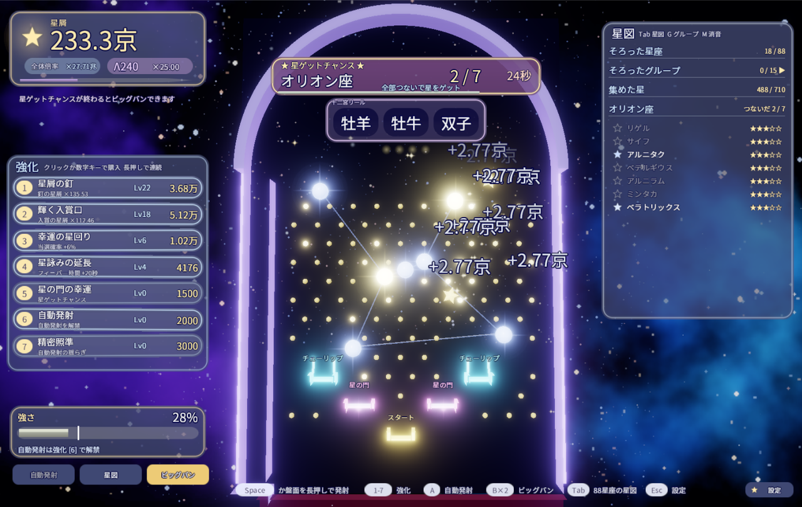
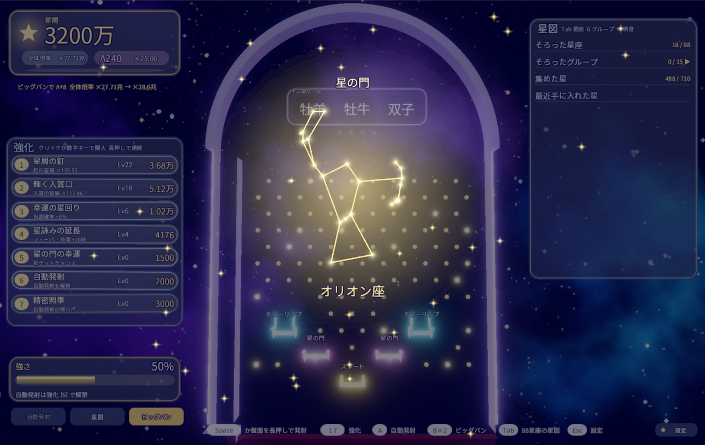
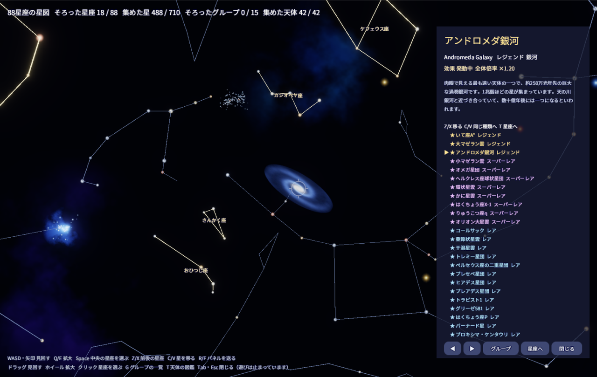
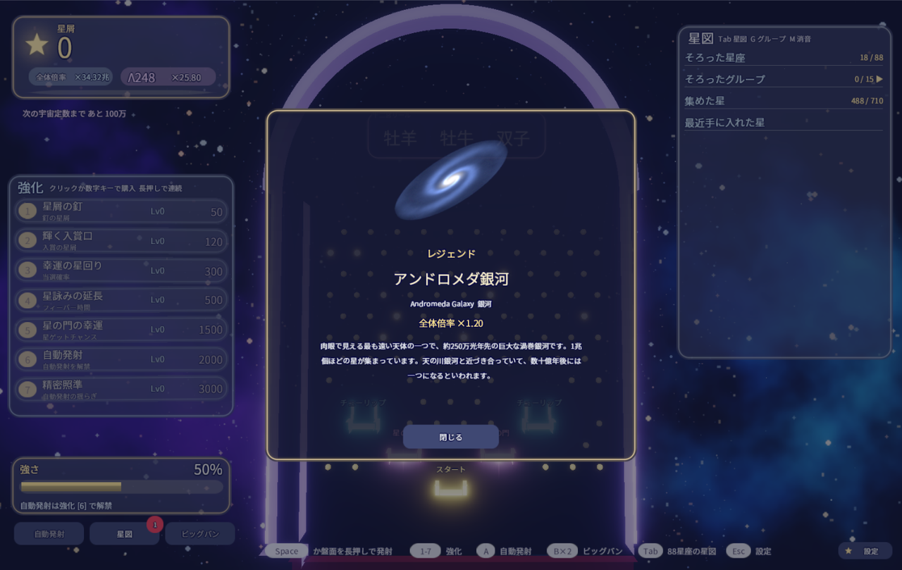

# Stardust Fever

星をモチーフにした、インフレ系のパチンコゲームです。
玉で星座を描いて本物の星を集め、数字が宇宙規模へふくらんでいく遊びを作りました。
自作のゲームエンジン [TsukinoEngine](https://github.com/tsukinokun/TsukinoEngine)（C++20 / DirectX 11）の上で動いています。



## 見どころ

- **本物の空を集める:** 88星座と、その線をつくる710個の星を、公開されている天文データから生成しました。位置、等級、スペクトル型、IAU の固有名はすべて実データです。
- **物理の盤面で星座を描く:** 星ゲットチャンスでは、選ばれた星座の形に星釘が並びます。玉を当てて全部つなぐと、その星座の星が手に入ります。玉の動きは Jolt Physics によるシミュレーションです。
- **3D の天球を見回す星図:** 天球の中心にカメラを置き、ドラッグやキーで空を回して集めた星を確かめます。マウスだけでも、キーボードだけでも操作できます。
- **星座ルーレット:** 星の門に入ると88星座の線画が入れ替わり、止まった星座がそのままチャンスの星座になります。惜しい外れ、復活、金色の予告があります。
- **ビッグバンと天体の収集:** 転生すると永続の宇宙定数と、星雲や銀河などの天体を1つ手に入れます。天体は42個で、レア度があり、確率はその宇宙の稼ぎで変わります。

| 星座ルーレット | 天球の星図 | 天体の入手 |
|---|---|---|
|  |  |  |

## 遊び方

1. 玉を打ち、釘と入賞口で星屑を稼ぐ
2. スタート入賞で黄道十二宮のリールが回り、当たると星詠みタイム（フィーバー）へ入る
3. 星の門に入ると星座ルーレットが回り、当たると星ゲットチャンスが始まる
4. 星を集めて星座とグループをそろえ、効果を得る
5. 星屑で台を強化し、稼いだらビッグバンで次の宇宙へ進む

| 操作 | キーボード | マウス |
|---|---|---|
| 発射 | Space 長押しで強さを溜めて離す | 盤面を長押し |
| 強化 | 1〜7（長押しで連続購入） | カードを押す（長押しで連続購入） |
| 自動発射 | A | 左下のボタン |
| ビッグバン | B を2回 | 左下のボタン |
| 星図 | Tab | 左下のボタン |
| 星図の中 | WASD で見回す、Q/E で拡大、Space で選ぶ、Z/X で移る、T で天体の図鑑 | ドラッグ、ホイール、クリック |
| 設定 | Esc | 右下のボタン |

## 技術

| 分類 | 使ったもの |
|---|---|
| 言語 | C++20 |
| エンジン | [TsukinoEngine](https://github.com/tsukinokun/TsukinoEngine)（自作） |
| 描画 | DirectX 11 |
| ECS | EnTT |
| 物理 | Jolt Physics |
| データ | cereal（Prefab JSON とセーブ） |
| 音 | DirectXTK Audio |
| ビルド | Premake5、Visual Studio 2022 |
| 素材の生成 | Python、Pillow |

ゲーム本体は264ファイル、約1.9万行で、System は50個あります。単体テストは59件です。

## 設計の工夫

- **ECS の分け方:** 入力、ゲームの状態、見た目を別の System に分けました。たとえば星の門の抽選は、結果を `StarChanceSystem` が決め、`StarGateFxSystem` は見せるだけです。演出を作り直しても当選確率に触れません。
- **System 同士はイベントでつなぐ:** 入賞、抽選、購入などの出来事はイベントで伝えます。効果音やセーブは、ゲームの処理を知らずにイベントを受け取るだけで動きます。
- **数値はコードの外へ:** System と Component の調整値は Prefab JSON に置き、ホットリロードできます。起動したまま遊びの調整ができます。
- **計算をエンジンから切り離す:** 確率、転生、星図の座標などの計算は `Core/` に置き、エンジンなしで単体テストしています。
- **素材はスクリプトから再現できる:** 星図のデータ、効果音、天体の絵は `Tools/` の16本の Python スクリプトから作ります。乱数の種を固定しているので、作り直しても同じ結果になります。

## 開発の進め方

このゲームは Claude Code と共同で開発しました。履歴の多くのコミットに、共同作業者の記録が残っています。

| 担当 | 内容 |
|---|---|
| 自分 | 土台の TsukinoEngine の開発、ゲームの企画、仕様と遊びの判断、調整の指示、動作の確認 |
| Claude Code | ゲーム側の実装の大部分、素材を生成するスクリプト、エンジンへの一部の機能追加、テストと画面の確認 |

作りたいものを言葉で決めて計画を確認し、動いた画面を見て直す、という流れを繰り返しました。TsukinoEngine は約1100コミットの個人開発で、Claude Code の記録があるのはそのうちの一部です。

## ビルド

必要なもの: Windows 10 / 11（x64）、Visual Studio 2022（C++ によるデスクトップ開発）

```bash
git clone --recurse-submodules https://github.com/tsukinokun/stardust-fever.git
```

```bash
open.bat
```

```bash
build.bat Release
```

`open.bat` がソリューションを生成します。実行ファイルは `bin\Release\StardustFever.exe` にできます。単体テストは `build.bat` の後に `bin\Debug\StardustFever.Tests.exe` で実行します。

## ディレクトリ構成

```text
StardustFever/
  src/, include/     ゲームのコード（Core: 計算、Data: マスターデータ、ECS: Component と System）
  Assets/            Prefab JSON、マスターデータ、絵、音
StardustFever.Tests/ 単体テスト
Tools/               データと素材を生成する Python スクリプト
Docs/                企画書（GDD.md）とクレジット
External/            TsukinoEngine（submodule）
```

## 今後の予定

多元宇宙（ビッグバンのさらに上の転生）、特殊な玉、ランダムイベントなどを企画書に載せています。まだ実装していません。

## クレジット

天体データ、音楽、効果音の出典は [Docs/Credits.md](Docs/Credits.md) にまとめています。星と星座のデータは Stellarium と HYG Database をもとにしており、CC BY-SA 4.0 です。
